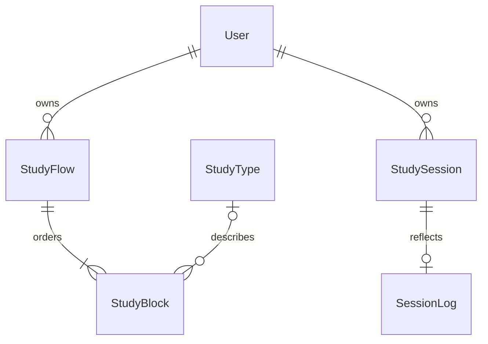

# Study database foundation (DB-01 / DB-02)

The website uses Express, PostgreSQL and Prisma. Better Auth's `User` is the
proposal's student owner. Its authentication `Session` is distinct from the
study entity `StudySession`. The HTTP v1 contract remains compatible with the
device adapter; its `SessionLog` TypeScript type names a session summary, while
the database `SessionLog` table holds the one-to-one reflection.

| Entity | Key / ordering | Ownership and deletion |
| --- | --- | --- |
| User | Better Auth ID | Server session supplies identity. Registration grants no privileged role. |
| StudyFlow | `(userId, kind, id)`; `position` | `kind` separates saved flows and private template snapshots, even with matching IDs. Owner deletion cascades. Template author is a display label, never authority. |
| StudyBlock | `(userId, flowKind, flowId, id)`; unique parent + `position` | Composite foreign key includes the owner. Flow deletion cascades to its blocks. Durations are 1–120 minutes. Total flow time is derived, not independently stored. |
| StudyType | Catalog ID | Optional block reference supports legacy/custom blocks without inventing a technique. Deletion of referenced catalog entries is restricted. Public catalog includes instructions, suggested minutes and research references. |
| StudySession | `(userId, id)`; saved list `position`; owner/date/subject indexes | Source flow ID, title and tag are historical values with no live foreign key. Editing/deleting the flow preserves the record. Duration/focus/status are actual saved values. Owner deletion cascades. |
| SessionLog | `(userId, sessionId)` | One reflection per session; composite foreign key prevents attaching it across owners. Session deletion cascades. Ratings are 1–5; notes are at most 5,000 characters. |

Imported templates are independent snapshots. `sourceTemplateId` records provenance
without linking future edits or deletion. Templates remain private until S2-02.
Session blocks are immutable planned snapshots on new records; old records
omit missing details. New timers also save validated per-block execution JSON; older records omit it. See
[history and report queries](HISTORY_REPORTS.md). Mentor/admin access still needs
an explicit permission design.

## Migration and rollback

`202611090001_study_entities` adds tables and a nullable digest without dropping
the existing `Workspace.data` document. On the first account read, the adapter
locks that owner's workspace, validates its existing document, inserts study
rows in batches, and checks an exact round trip before committing. Unsupported
data fails without resetting the document or changing committed study records.

Subsequent reads use the study tables. Writes update changed rows and the JSON
compatibility mirror in one transaction under the same account lock. Prepending
a session shifts existing positions in a batch. Concurrent requests cannot
overwrite each other's records; import retries retain their stable IDs.

The digest detects JSON writes made by the previous deployment. The next request
reconciles them under the lock. This allows an application rollback while preview
and production still share a database. Do not remove the mirror or rename/drop
columns until preview storage is separate, a backup has been restored in a test,
and all deployed writers use the new adapter. A provider backup and restore drill
remain OPS-01; the mirror is not a backup.

The history migration adds nullable session block JSON, an owner/date/ID index,
and workspace revision/normalization markers for bounded reads. Older serializers
cannot erase known optional snapshots for an unchanged session core.

## Fresh setup and verification

Use `npm ci`, `npm run db:migrate`, `npm run db:seed`, and `npm run build` inside
`backend`, with a local PostgreSQL URL and auth settings from its README.
`npm run dev:local` provisions the isolated local database and migrates it.
The seed is repeatable and changes only the shared technique catalog; first use
also seeds the catalog for a new/migrated account.

`npm test` covers two-account routes, restart persistence, order, retained history
after flow deletion, duplicate imports, failed transactions, malformed legacy
data preservation, rolling rollback writes, cascade deletion, repeatable seed,
and a 5,000-session history. Locally it uses disposable Prisma Postgres; CI also
runs the account/transaction suite against PostgreSQL 17.

## Research catalog

The toolkit links to original research on
[retrieval](https://doi.org/10.1126/science.1152408),
[distributed practice](https://doi.org/10.1037/0033-2909.132.3.354),
[interleaved mathematics practice](https://doi.org/10.1007/s11251-007-9015-8), and
[self-explanation](https://doi.org/10.1207/s15516709cog1302_1).
Suggested timer durations are product defaults, not intervals prescribed by
those studies. The Feynman label points to self-explanation research; the UI
does not claim validation of a branded method. Focus and break blocks are
practical workflow options, without invented research endorsements.
